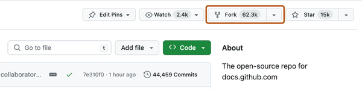
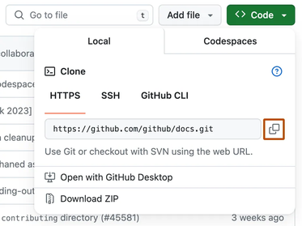
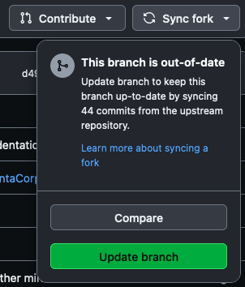
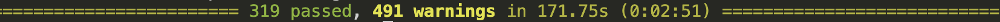

> [!NOTE]
> You can find our code at https://github.com/thousandbrainsproject/tbp.monty
>
> This is our open-source repository. We call it **Monty** after Vernon Mountcastle, who proposed cortical columns as a repeating functional unit across the neocortex.

> [!WARNING]
> This guide will not work on Windows or non-`x86_64/amd64` Linux.
>
> A guide for Windows Subsystem for Linux is available here: [Getting Started on Windows via WSL](getting-started/getting-started-on-windows-via-wsl.md)
>
> You can follow these GitHub issues for updates:
> - [Windows native](https://github.com/thousandbrainsproject/tbp.monty/issues/52)
> - [Raspberry Pi](https://github.com/thousandbrainsproject/tbp.monty/issues/85)
>
> If you run into problems, please let us know by [opening a GitHub issue](https://github.com/thousandbrainsproject/tbp.monty/issues/new/choose) or [posting in the Monty Code section of our forum](https://forum.thousandbrains.org/c/monty-code/6).

# 1. Get [the Code](https://github.com/thousandbrainsproject/tbp.monty)

## 1.1 Fork the Repository

It is best practice (and required if you ever want to contribute code) first to **make a fork of our repository** and then make any changes on your local fork. To do this you can simply [visit our repository](https://github.com/thousandbrainsproject/tbp.monty) and click on the fork button as shown in the picture below. For more detailed instructions see the [GitHub documentation on Forks](https://docs.github.com/en/pull-requests/collaborating-with-pull-requests/working-with-forks/fork-a-repo).



## 1.2 Clone the Repository

Next, you need to **clone the repository onto your device**. To do that, open the terminal, navigate to the folder where you want the code to be downloaded and run `git clone repository_path.git`. You can find the `repository_path.git` on GitHub by clicking on the `<>Code` button as shown below. For more details see the [GitHub documentation on cloning](https://docs.github.com/en/pull-requests/collaborating-with-pull-requests/working-with-forks/fork-a-repo#cloning-your-forked-repository).




> [!NOTE]
> If you want the same setup as we use at the Thousand Brains Project by default, clone the repository at `${HOME}/tbp/`. If you don't have a `tbp` folder in your home directory yet you can run `cd ~; mkdir tbp; cd tbp` to create it. It's not required to clone the code in this folder but it is the path we assume in our tutorials.

## 1.3 Make Sure Your Local Copy is Up-to-Date

If you just forked and cloned this repository, you may skip this step, but any other time you get back to this code, you will want to synchronize it to work with the latest changes.

To make sure your fork is up to date with our repository you need to click on `Sync fork` -> `Update branch` in the GitHub interface. Afterwards, you will need to **get the newest version of the code** into your local copy by running `git pull` inside this folder.




You can also update your code using the terminal by running `git pull upstream main`. If you have not linked the upstream repository yet, you may first need to call `git remote add upstream https://github.com/thousandbrainsproject/tbp.monty.git`

> [!TIP]
> In certain situations you might get the following error after running `git pull upstream main`:
> ```
>   hint: Diverging branches can't be fast-forwarded, you need to either:
>   hint:
>   hint:   git merge --no-ff
>   hint:
>   hint: or:
>   hint:
>   hint:   git rebase
>   hint:
>   hint: Disable this message with "git config set advice.diverging false"
>   fatal: Not possible to fast-forward, aborting.
> ```
> This is usually caused by your `main` branch containing commits that aren't in the upstream `main` branch. The quickest way to resolve this is to reset your `main` branch to point to the same commit as the upstream `main` branch:
> ```
> git reset upstream/main
> ```
> This will make the two branches point to the same commit while keeping any changes in the local branch on disk. Then you can make a new branch and commit those changes. 
> 
> If you don't want to keep those changes, you can add `--hard` to this command to have Git reset the on disk files to match the upstream branch.

# 2. Set up Your Environment

## 2.1 Install uv
Monty requires Astral's uv to install its dependencies. For instructions on how to install uv on your machine see <https://docs.astral.sh/uv/getting-started/installation/>

> [!NOTE]
> While Astral suggests using `curl ... | sh`, we would recommend using your system's package manager or a tool like Homebrew to install it. See the instructions further down their Getting Started page for details.

## 2.2 Set up Monty
To set up Monty, **use the uv commands below**.

**Make sure to `cd` into the `tbp.monty` directory before running these commands.**

You can create and activate the environment with the following commands:

```shell
uv sync --extra=dev --extra=simulator_mujoco
```

> [!NOTE]
> If you'd prefer to not have to prefix Python commands with `uv run`, you can activate the environment using the activation scripts that are provided in the virtual environment.
> 
> For example, under bash or zsh run `source .venv/bin/activate`. There are versions for other shells available in that directory, e.g. fish, nushell, etc.
>
> **The instructions below will show the commands with `uv run`**, so be sure to remove that if you activated the environment.

# 3. Run the Code 🎉

The best way to see whether everything works is to **run the unit tests** using this command:

```shell
uv run pytest
```

Running the tests might take a little while (depending on what hardware you are running on), but in the end, you should see something like this:




Note that by the time you read that, there may be more or less unit tests in the code base, so the exact numbers you see will not match with this screenshot. The important thing is that all tests either pass or are skipped and **none of the tests fail**.

# 4. Run an Experiment

In your usual interaction with this code base, you will most likely run experiments, not just unit tests. You can find experiment configs in the `src/tbp/monty/conf/experiment` folder.

## 4.1 Download the YCB Dataset

A lot of our current experiments are based on the [YCB dataset](https://www.ycbbenchmarks.com/) which is a dataset of 77 3D objects that we render in MuJoCo. To download the dataset, run

```shell tgz
mkdir -p ~/tbp/data/mujoco/objects/ycb

cd ~/tbp/data/mujoco/objects/ycb

curl -L https://tbp-data-public-5e789bd48e75350c.s3.us-east-2.amazonaws.com/tbp.monty/ycb_objects_1.0.tgz | tar -xvf -
```
```shell zip
mkdir -p ~/tbp/data/mujoco/objects/ycb

cd ~/tbp/data/mujoco/objects/ycb

curl -O https://tbp-data-public-5e789bd48e75350c.s3.us-east-2.amazonaws.com/tbp.monty/ycb_objects_1.0.zip

unzip ycb_objects_1.0.zip
```

## 4.2 Download Pretrained Models

| Models | Archive Format | Download Link |
| --- | --- | --- |
| pretrained_ycb_v14 | tgz |  [pretrained_ycb_v14.tgz](https://tbp-pretrained-models-public-c9c24aef2e49b897.s3.us-east-2.amazonaws.com/tbp.monty/pretrained_ycb_v14.tgz) |
| pretrained_ycb_v14 | zip |  [pretrained_ycb_v14.zip](https://tbp-pretrained-models-public-c9c24aef2e49b897.s3.us-east-2.amazonaws.com/tbp.monty/pretrained_ycb_v14.zip) |

Unpack the archive in the `~/tbp/results/monty/pretrained_models/` folder. For example:

```plaintext tgz
mkdir -p ~/tbp/results/monty/pretrained_models/

cd ~/tbp/results/monty/pretrained_models/

curl -L https://tbp-pretrained-models-public-c9c24aef2e49b897.s3.us-east-2.amazonaws.com/tbp.monty/pretrained_ycb_v14.tgz | tar -xzf -
```
```plaintext zip
mkdir -p ~/tbp/results/monty/pretrained_models/

cd ~/tbp/results/monty/pretrained_models/

curl -O https://tbp-pretrained-models-public-c9c24aef2e49b897.s3.us-east-2.amazonaws.com/tbp.monty/pretrained_ycb_v14.zip

unzip pretrained_ycb_v14.zip
```


The folder should then have the following structure:

```
~/tbp/results/monty/pretrained_models/
|-- pretrained_ycb_v14/
|   |-- supervised_pre_training_5lms
|   |-- supervised_pre_training_5lms_all_objects
|   |-- ...
```

> [!NOTE]
> To unpack an archive you should be able to double-click on it.
>
> To unpack via the command line, copy the archive into the `~/tbp/results/monty/pretrained_models/` folder and inside that folder run:
> - for a `tgz` archive, `tar -xzf pretrained_ycb_v13.tgz`.
> - for a `zip` archive, `unzip pretrained_ycb_v13.zip`.

## [Optional] Set Environment Variables

### MONTY_MODELS

If you did not save the pre-trained models in the `~/tbp/results/monty/pretrained_models/` folder, you will need to set the **MONTY_MODELS** environment variable.

```shell
export MONTY_MODELS=/path/to/your/pretrained/models/dir
```

This path should point to the `pretrained_models` folder that contains the `pretrained_ycb_v14` folders.


### MONTY_DATA

If you did not save the data (e.g., YCB objects) in the `~/tbp/data` folder, you will need to set the **MONTY_DATA** environment variable.

```shell
export MONTY_DATA=/path/to/your/data
```

This path should point to the `data` folder, which contains data used for your experiments. Examples of data stored in this folder are the `habitat` folder containing YCB objects, the `worldimages` folder containing camera images for the 'Monty Meets Worlds' experiments, and the `omniglot' folder containing the Omniglot dataset.

### MONTY_LOGS

If you would like to log your experiment results in a different folder than the default path (`~/tbp/results/monty/`) you need to set the **MONTY_LOGS** environment variable.

```shell
export MONTY_LOGS=/path/to/log/folder
```

### WANDB_DIR

We recommend not saving the wandb logs in the repository itself (default save location). If you have already set the MONTY_LOGS variable, you can set the directory like this:

```shell
export WANDB_DIR=${MONTY_LOGS}/wandb
```

## 4.3 Run the Experiment

Now you can finally run an experiment! To do this, simply use this command:

```shell
uv run python run.py experiment=my_experiment
```

Replace `my_experiment` with the name of one of the experiment configs in `src/tbp/monty/conf/experiment`. For example, a good one to start with could be `randrot_noise_10distinctobj_surf_agent`.

If you want to run an experiment with parallel processing to make use of multiple CPUs, simply use the `run_parallel.py` script instead of the `run.py` script like this:

```shell
uv run python run_parallel.py experiment=my_experiment
```

# 5. What Next?
A good next step to get more familiar with our approach and the Monty code base is to go through our [tutorials](./tutorials.md). They include follow-along code and detailed explanations on how Monty experiments are structured, how Monty can be configured in different ways, and what happens when you run a Monty experiment.

If you would like to contribute to the project, you can have a look at the many potential [ways to contribute](../contributing/contributing.md), particularly [ways to contribute code](../contributing/ways-to-contribute-to-code.md).

You can also have a look at the [capabilities of Monty](../overview/vision-of-the-thousand-brains-project/capabilities-of-the-system.md) and our [project roadmap](../future-work/project-roadmap.md) to get an idea of what Monty is currently capable of and what features our team is actively working on.

If you run into any issues or questions, please head over to our [Discourse forum](https://forum.thousandbrains.org/) or [open an Issue](../contributing/contributing.md#report-an-issue). We are always happy to help!
