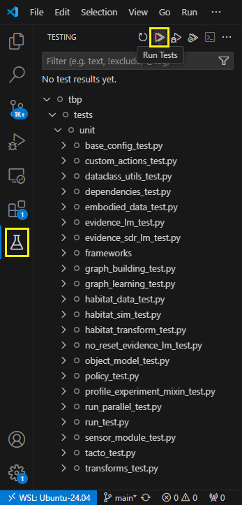
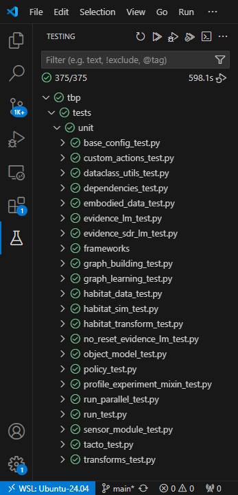

This guide will enable you to develop with Monty using VS Code on any supported platform.

# 1. Setup

1. Complete the [Getting Started](../getting-started.md) tutorial.

1. Install Visual Studio Code: https://code.visualstudio.com/download

1. Install the Python extension: https://marketplace.visualstudio.com/items?itemName=ms-python.python

1. Install the Pyrefly extension: https://marketplace.visualstudio.com/items?itemName=meta.pyrefly

1. Install the Ruff extension: https://marketplace.visualstudio.com/items?itemName=charliermarsh.ruff

1. Initialize the settings file using the provided example:

   ```shell
   cp ~/tbp/.vscode/settings.example.json ~/tbp/.vscode/settings.json
   ```

1. Then, launch VS Code with Monty:

   ```shell
   cd ~/tbp && code .
   ```

# 2. Run and Debug

You can create a run configuration to debug experiments and benchmarks.

1. In the top menu, select:
   * Run > Add Configuration
   * Python Debugger
   * Python File with Arguments
1. Change both `"name"` and `"program"` to `"run.py"`
1. Optionally, change `"args"` to an experiment or benchmark of your choice, e.g. `"experiment=randrot_noise_10distinctobj_surf_agent"`, or leave the default value if you want a popup box to manually specify the arguments on every run.
1. In the top menu, select: View > Run
1. In the bottom left, under "Breakpoints", enable "User Uncaught Exceptions"
1. To test, select in the top menu: Run > Start Debugging
1. Use the debug controls at the top as needed.

Multiple configurations can be created for different experiments and benchmarks.

To pass custom environment variables to Python when running via VS Code, you can create a `.env` file in `~/tbp` containing those variables, one per line (e.g. `WANDB_MODE=offline`).

# 3. Unit Tests

The unit tests can be run directly in VS Code:



This will take some time, about 10 minutes on an 8-core CPU for example:


